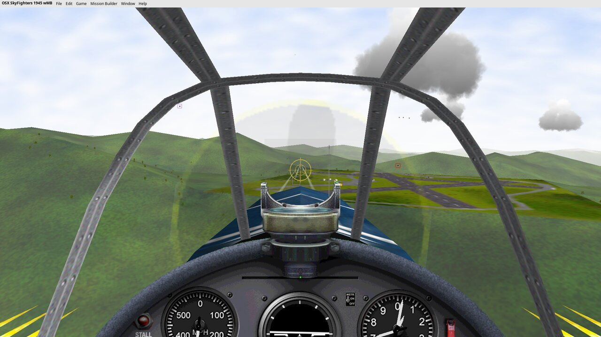
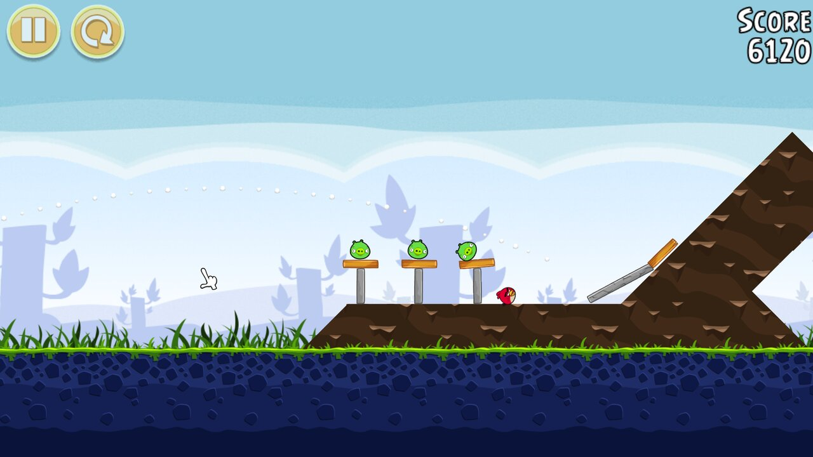
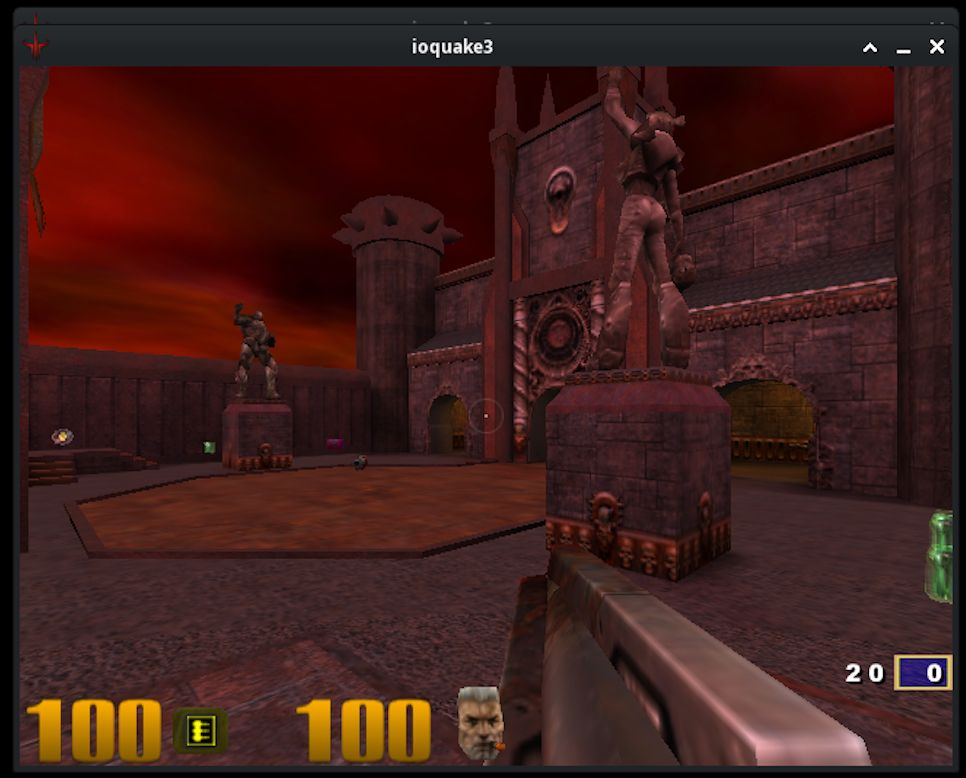

For years, the honest answer to "does this app run in Darling?" was usually "probably not". That is slowly starting to change, and we finally have a place to keep track of it: the Darling AppDB. In this post, I'll show you the AppDB, some old Mac games that you can now play on Linux again, the first GUI applications that ship with Darling itself, and a bit of news on the ARM64 front.

<!-- truncate -->

## Introducing the AppDB

We have launched an application compatibility database at [appdb.darlinghq.org](https://appdb.darlinghq.org/). It is still mostly empty, but we hope it will grow over time as more applications start working and more people report their results.

All compatibility reports live in a Git repository: [darlinghq/darling-appdb-database](https://github.com/darlinghq/darling-appdb-database). The website loads its data from there, so the reports are open, versioned and reviewable like any other part of the project. If something is wrong or out of date, it can be fixed with a pull request.

You don't need to know your way around the repository to contribute, though. The website offers a wizard, available after you log in with GitHub, that walks you through submitting a new report and raises it as a pull request for you. If you've tried an application in Darling, whether it worked or not, please let us know there. (That being said, things are still more likely to not work, so we prefer positive reports.)

## Getting Old Games Running

Along with other contributors, I am working on getting more and more applications to run. My own current focus is on older Mac games, and we already have the first results.

An older version of [Angry Birds](https://appdb.darlinghq.org/software/AngryBirds) now works in Darling. So does [SkyFighters 1945](https://appdb.darlinghq.org/software/SkyFighters1945).

SkyFighters 1945 is a good example of why this matters. Its developer passed away more than ten years ago, so the game will never receive another update. It is an i386-only application, and Apple dropped support for 32-bit applications back in macOS Catalina. Until now, the only ways to play it were on old Apple hardware, or perhaps on a Hackintosh with working OpenGL support. Now you can also play it on Linux.

The same applies to this version of Angry Birds, which is also i386-only. The franchise does have newer releases that run on modern hardware, but the original Mac version is stuck in the same place as SkyFighters.

Getting these games to run took more than implementing the documented APIs. Both Angry Birds and SkyFighters 1945 relied on undocumented or outright buggy behavior of macOS, which happened to work on the systems they were written for. This puts us in the same situation as Wine: being compatible with the documentation is not enough, we also have to be compatible with the quirks that real applications came to depend on.

We also tried an older ioquake3 release from 2009, and it worked too. Of course, ioquake3 is open source and you can play it natively on Linux, so why bother? Because we want to make sure we cover the older APIs as well, not just the current ones. i386 in particular can be tricky to get right, due to things like the fragile Objective-C ABI used by 32-bit applications. Every old application that runs gives us more confidence that we got those details right.

Running a 15-year-old game would be no feat on Windows. Microsoft takes backwards compatibility (fairly) seriously, and old games usually just run. In Apple's world, however, 15 years is ancient history: the platform has gone through several architecture transitions and has dropped entire generations of software along the way.

This is where Darling can do better than Apple. Our goal is to keep supporting what Apple has thrown away, so that software people paid for, or software whose authors are no longer around to update it, does not simply disappear.

## Darling's Own GUI Applications

In our [last update](/2026/11/08/development-update-q4-2026#longer-term), I mentioned that I would like Darling to ship its own GUI applications. That work has now started.

We have started building Apple's open source version of TextEdit.app as part of Darling. We have also added Console.app. Despite the name, it is not a terminal emulator: just like on macOS, Console.app is a viewer for system log messages.

We have also started building our own "Finder" app. Its main goal is to make it easy to mount DMG files and copy applications into the Darling prefix, and to see which applications are installed. Today, all of this requires the command line, and we'd like getting an application into Darling to be as simple as it is on a Mac.

Besides being useful on their own, these applications serve as real-world tests of our AppKit support.

## ARM64 Builds in CI

Following up on the [initial ARM64 support](/2026/11/08/development-update-q4-2026#arm64-support) mentioned in our last update, our CI now builds Darling on ARM64 as well. This helps us catch architecture-specific breakage early, rather than finding out about it after the fact.

We would love to support the Raspberry Pi too. That is not as simple as it sounds: applications built for Apple silicon may use instructions that are available on Apple's CPUs but not on the cores found in the Raspberry Pi. To run such applications there, we will first have to add emulation of those instructions.

## Get Involved

If you want to help, the easiest way to start is to try an application in Darling and [submit a report to the AppDB](https://appdb.darlinghq.org/). If you'd like to help get more applications working, come talk to us on [our Discord](https://discord.gg/XRD3mQA).

You can also support the project financially through our [OpenCollective](https://opencollective.com/darlinghq). The funds will be used to cover infrastructure and hosting costs, and perhaps LLM costs.
